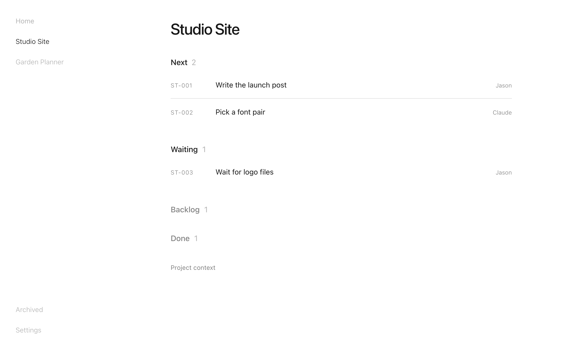

# Torch

**A local, free alternative to Linear.** Issue tracking, a dashboard and project memory for you and your AI agents, kept in plain Markdown files in your repo. Nothing leaves your machine.

<picture>
  <source media="(prefers-color-scheme: dark)" srcset="docs/dashboard-dark.png">
  
</picture>

- **Plain files.** Each project gets a `.torch/` folder: a one-page `CONTEXT.md` and one Markdown file per task. Read or edit them with anything.
- **A local dashboard.** `torch dashboard` opens every project and task in your browser, served from `127.0.0.1`. Nothing else can reach it.
- **Built for agents.** Five skills teach Claude Code and Codex to plan, pick up, finish and record work, so a new session knows where things stand without you explaining it again.
- **No account, no server, no sync, no telemetry.** Git moves your records if you commit them.

## Install with your agent

Copy this into Claude Code, Codex or another coding agent:

```text
Install Torch (https://github.com/cs-jason/torch) for me. Do a security review before you install anything.

1. Security review first. Clone the repository into a temporary folder and read every file in src/, public/, skills/ and package.json. Check and report:
   - Network: the only server is the dashboard, and it listens on 127.0.0.1. There are no other outgoing requests, no telemetry and no analytics. The only other program it starts is your browser, to open the dashboard.
   - Install: package.json has no preinstall, install or postinstall scripts. The dependencies are only yaml, marked and sanitize-html (and their own dependencies).
   - Files: Torch writes only to the project's .torch/ folder, a short marked block in AGENTS.md (in the project and in folders you link), its own folder ~/.config/torch, and skill links in ~/.claude/skills and ~/.codex/skills. Only `torch init --public` adds .github/workflows/torch-guard.yml.
   - Nothing reads or sends credentials, SSH keys, browser data or files outside the project.
   Tell me what you found in a few lines. If anything is different from this list, stop and show me the code.

2. Only after I say yes:
   - npm install -g github:cs-jason/torch   (needs Node 22 or newer)
   - torch owner "<my name>"
   - torch skills install
   - In this project folder: torch init, then use the torch-start skill to write CONTEXT.md and the first tasks.
   - Start the dashboard with: torch dashboard

3. Show me the three commands I will use most: torch, torch needs and torch dashboard.
```

## Install yourself

Torch needs Node 22 or newer.

```sh
npm install -g github:cs-jason/torch
torch owner "Your name"
torch skills install      # links the skills into ~/.claude/skills and ~/.codex/skills
cd your-project
torch init                # writes .torch/ and a short block in AGENTS.md
torch dashboard           # opens http://127.0.0.1:6421 — Control-C stops it
```

Then ask your agent to use **torch-start** to describe the project and add the first tasks.

## The dashboard

`torch dashboard` serves the same `.torch/` files as the CLI, on `127.0.0.1` only. Use `--port 6500` to choose a port and `--no-open` to skip opening the browser.

- **Home:** the next tasks and the most recent changes across projects.
- **Projects:** tasks grouped by Next, Waiting, Backlog and Done. Drag projects in the sidebar to reorder them.
- **Tasks:** the current state, linked documents and every checkpoint.
- **Search:** ⌘K finds any task, project or command.

The dashboard has dark mode, keyboard navigation and copy-a-reference buttons that give your agent a precise pointer to a task.

## Skills

| Skill | Ask for it like this |
|---|---|
| torch-start | "Set up Torch here." |
| torch-list | "What needs me?" · "What's going on with Studio Notes?" |
| torch-plan | "Plan the next steps for this project." |
| torch-work | "Work on ST-003." · "Pick up the next task." |
| torch-tidy | "Tidy this project's tasks." |

## CLI

For you (plain text when piped):

```sh
torch                         # this project's card, or every project when outside one
torch needs                   # everything waiting on you, across projects
torch studio                  # one project by code or name
torch ST-003                  # one task: why, done, next and the last checkpoints
torch dashboard               # the local dashboard
cd $(torch path studio)       # jump to a project's folder
```

For agents:

```sh
torch context [ID]            # project context and open tasks, or one task with recent checkpoints
torch task list | show | add | update | checkpoint | link | archive | restore | merge | recover
torch init [folder]           # add a project
torch link <task-home> [dir]  # attach a code or notes folder to an existing project
torch projects · torch owner · torch doctor · torch skills install
torch help [rules | setup | projects | tasks | organize]
```

- **Readable IDs work from any folder:** `torch context ST-003` finds its project through `~/.config/torch`.
- **Writes need a fresh `--revision`:** a stale one is refused, so two agents can't overwrite each other.
- **Sessions link automatically** for Codex and Claude Code.
- `torch doctor` checks your setup and warns when a CONTEXT.md or a task grows too long.

## The format

```
.torch/
  project.json   id, name, two-letter code, next task number
  CONTEXT.md     the project on one page: what, goal now, state, decisions, sources
  README.md      a short pointer for agents
  tasks/         one Markdown file per task: YAML frontmatter + current state
  notes/<task>/  checkpoints, the task's history
  history/       old versions saved by torch-tidy
```

- **Frontmatter:** `displayId` (such as ST-003), `id`, `title`, `status`, `owner`, `created`, `updated`, linked sessions, and archive fields when relevant.
- **Body:** the current state only: **Why**, **Done**, **Access**, **Next** and optional **Steps**.
- **Statuses:** `next`, `waiting`, `backlog` and `done`. A task "needs you" when you own it and it's `next` or `waiting`. Keep about five tasks `next`; `torch doctor` warns past five.
- The rules agents follow live in one place: `torch help rules`.

## Committing `.torch/`

You can commit `.torch/` with your code; `torch init` writes `.torch/.gitignore`, so only the records are tracked.

- **One agent per task.** Only the task's owner writes it.
- **One place adds tasks.** Add tasks and edit CONTEXT.md only in the main checkout, so two copies never pick the same task number.
- **Credentials are refused.** A record that looks like it holds a key, token, private key or password in a URL is not written, and `torch doctor` flags any already in `.torch/`.
- **Public repositories:** `torch init --public` adds a GitHub check. It fails pull requests from outsiders that touch `.torch/`, and any change that adds something credential-shaped. Make the check required in branch protection.

## FAQ

**Why local?** Your plans and notes stay on your machine, next to the code they describe. Torch works offline, needs no account and has no server to keep running.

**Why plain files?** Agents already read and write files well. Markdown in your repo is easy to search, diff, back up and move, and you can stop using Torch at any time without losing anything.

**How do I uninstall it?**

```sh
npm uninstall -g @jasoncjs/torch
rm ~/.claude/skills/torch-* ~/.codex/skills/torch-*   # the skill links
rm -r ~/.config/torch                                  # the project list and dashboard settings
```

Your `.torch/` folders stay in your projects. Delete them too if you don't want the records.

## License

MIT
